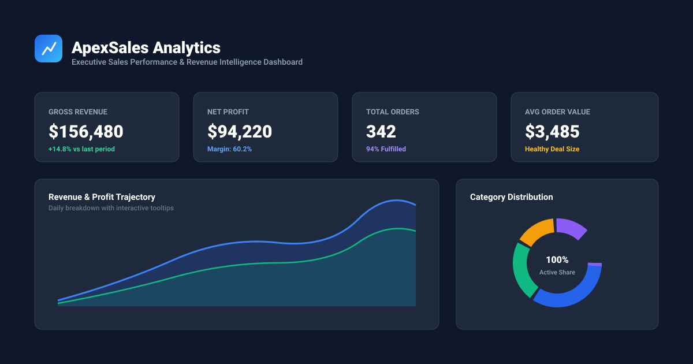

# ApexSales — Sales Analytics Dashboard

A lightweight, high-performance sales analytics dashboard built with vanilla web technologies. Zero backend, zero external runtime dependencies, zero CSS variables, and persistent browser storage via `localStorage`.



## Features

- **Executive KPI Cards**: Real-time Gross Revenue, Net Profit, Orders, and Average Order Value (AOV) with trend percentages.
- **Pure Canvas Visualizations**:
  - **Revenue & Profit Velocity**: Smooth bezier area chart with hover crosshairs and tooltips.
  - **Category Breakdown**: Interactive donut chart with breakdown by product category.
  - **Channel & Regional Reach**: Bar chart toggling between acquisition channels and sales regions.
  - **Sales Rep Leaderboard**: Dynamic ranking of sales representatives by revenue and quota fulfillment.
- **Interactive Sales Ledger**:
  - Live search across customers, invoice IDs, and products.
  - Multi-criteria filtering by category, payment status, and custom timeframes.
  - Multi-column ascending and descending sorting.
  - Paginated view with custom page limits.
  - Full receipt view, record editing, and deletion.
- **Record Sale Modal**: Dynamic modal with live profit margin and revenue calculations.
- **CSV Data Export**: One-click download of all filtered records to `.csv`.
- **Persistent Local WebStorage**: All changes persist automatically to browser `localStorage` with a one-click sample data reset button.

## Tech Stack & Architecture

- **Vanilla HTML5**: Semantic, accessible markup.
- **Vanilla CSS3**: Modern responsive layout using flexbox and grid, written **strictly without CSS variables** (`var(--...)`).
- **Vanilla JavaScript**: Pure ES6+ client-side logic and custom HTML5 Canvas rendering engine with HiDPI support.
- **Zero Dependencies**: Completely self-contained, working 100% offline without CDNs or frameworks.

## Quick Start

Simply clone the repository and open `index.html` in any modern web browser:

```bash
git clone https://github.com/lona-design/sales-analytics-dashboard.git
cd sales-analytics-dashboard
open index.html
```

Or serve with any static server:

```bash
npx serve .
# or
python3 -m http.server 8000
```

## License

MIT License.
